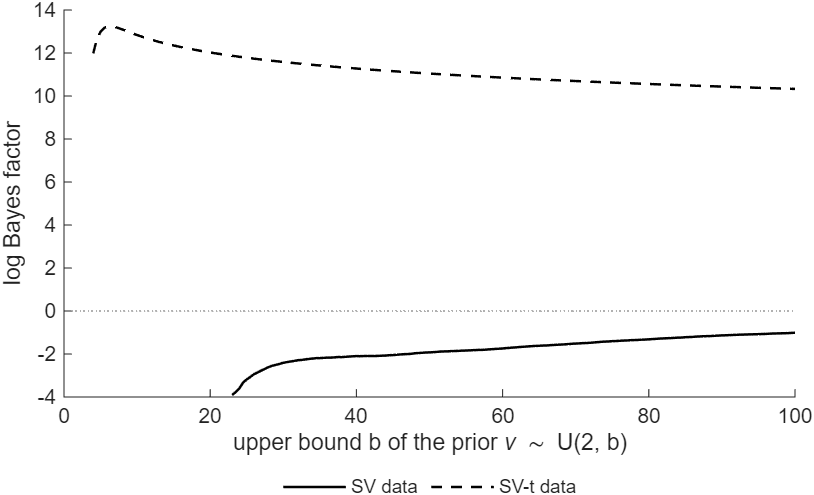

# How to Compare Stochastic Volatility Models by the Marginal Likelihood

*Code: [`guide.m`](guide.m), with [`ssm.intlike_sv`](../../core/+ssm/intlike_sv.m),
[`ssm.intlike_sv_t`](../../core/+ssm/intlike_sv_t.m) and
[`ssm.ksc_ar1_mean`](../../core/+ssm/ksc_ar1_mean.m). Method:
[Chan and Grant (2016)](../../CITING.md#chan-and-grant-2016b),
[Chan and Eisenstat (2015)](../../CITING.md#chan-and-eisenstat-2015) and
[Chan (2027)](../../CITING.md#chan-2027).*

We use marginal likelihoods to choose among three models of a series: a constant variance,
stochastic volatility (SV) and SV with Student-$`t`$ errors (SV-$`t`$). The integrated likelihood
of an SV model, with the log-volatilities integrated out, has no closed form.
[`ssm.intlike_sv`](../../core/+ssm/intlike_sv.m) and
[`ssm.intlike_sv_t`](../../core/+ssm/intlike_sv_t.m) estimate it by importance sampling.
Importance sampling over the parameters then gives the marginal likelihood.

On data generated by SV, SV has the largest marginal likelihood, 1.01 above SV-$`t`$ and 159.64
above the constant variance. On data generated by SV-$`t`$, SV-$`t`$ has the largest, 10.33 above
SV and 206.08 above the constant variance.

To draw the figure first, run from the root of the repository:

```matlab
run guides/sv_compare/guide.m
```

It takes about three minutes on the machine that produced this page.

## The Three Models

The SV model of [How to Estimate a Stochastic Volatility Model by Gibbs Sampling](../sv_gibbs/)
is

$$y_t = \mu + \mathrm{e}^{h_t/2}\varepsilon_t, \qquad \varepsilon_t \sim \mathcal{N}(0, 1), \qquad\qquad h_t = \mu_h + \phi(h_{t-1} - \mu_h) + u_t, \qquad u_t \sim \mathcal{N}(0, \sigma_h^2),$$

with $`h_1 \sim \mathcal{N}(\mu_h, \sigma_h^2/(1 - \phi^2))`$. SV-$`t`$, the model of
[How to Add Student-t Errors to a Stochastic Volatility Model](../sv_t/), replaces
$`\varepsilon_t`$ by $`\sqrt{\lambda_t}\,\varepsilon_t`$ with
$`\lambda_t \sim \mathcal{IG}(\nu/2, \nu/2)`$. The errors then follow a Student-$`t`$ distribution
with $`\nu`$ degrees of freedom. The constant variance is the SV model with $`\sigma_h^2 = 0`$, so
that $`h_t = \mu_h`$ in every period and $`y_t \sim \mathcal{N}(\mu, \mathrm{e}^{\mu_h})`$.

We follow Chan and Grant (2016) to set the priors:

$$\mu \sim \mathcal{N}(0, 10), \qquad \mu_h \sim \mathcal{N}(1, 10), \qquad \phi \sim \mathcal{TN}_{(-1,1)}(0.97, 0.1^2), \qquad \sigma_h^2 \sim \mathcal{IG}(5, 0.16), \qquad \nu \sim \mathcal{U}(2, 100).$$

The constant variance has the priors of $`\mu`$ and $`\mu_h`$. The models differ in their
parameters:

| Model | Parameters |
|---|---|
| Constant variance | $`\mu`$, $`\mu_h`$ |
| SV | $`\mu`$, $`\mu_h`$, $`\phi`$, $`\sigma_h^2`$ |
| SV-$`t`$ | $`\mu`$, $`\mu_h`$, $`\phi`$, $`\sigma_h^2`$, $`\nu`$ |

We use two data sets in percent, each with $`T = 1000`$, $`\mu = 0.1`$, $`\mu_h = 0`$,
$`\phi = 0.97`$ and $`\sigma_h^2 = 0.04`$. The first is the data of
[How to Draw the Log-Volatilities of a Stochastic Volatility Model](../sv_states/), generated by
SV. The second is the data of the third guide, generated by SV-$`t`$ with $`\nu = 5`$. Both
share the same log-volatilities and errors $`\varepsilon_t`$, so only the tails differ.

## Step 1: Integrate the Log-Volatilities Out

Let $`\boldsymbol{\theta}`$ hold the parameters of a model. The integrated likelihood averages the
likelihood over the log-volatilities $`\mathbf{h} = (h_1, \ldots, h_T)'`$:

$$p(\mathbf{y} \mid \boldsymbol{\theta}) = \int p(\mathbf{y} \mid \mathbf{h}, \boldsymbol{\theta})\,p(\mathbf{h} \mid \boldsymbol{\theta})\,d\mathbf{h}.$$

Chan and Grant (2016) estimate it by importance sampling. The importance density is
$`\mathcal{N}(\hat{\mathbf{h}}, \mathbf{K}_{\mathbf{h}}^{-1})`$, where $`\hat{\mathbf{h}}`$ is the
mode of $`p(\mathbf{h} \mid \mathbf{y}, \boldsymbol{\theta})`$ and $`\mathbf{K}_{\mathbf{h}}`$ the
negative Hessian of its log there. Newton's method finds the mode, and the banded
$`\mathbf{K}_{\mathbf{h}}`$ makes each step cheap. With $`M`$ draws
$`\mathbf{h}^{(i)}`$ from this density,

$$\hat{p}(\mathbf{y} \mid \boldsymbol{\theta}) = \frac{1}{M}\sum_{i=1}^{M} \frac{p(\mathbf{y} \mid \mathbf{h}^{(i)}, \boldsymbol{\theta})\,p(\mathbf{h}^{(i)} \mid \boldsymbol{\theta})}{f_{\mathcal{N}}(\mathbf{h}^{(i)};\, \hat{\mathbf{h}}, \mathbf{K}_{\mathbf{h}}^{-1})}.$$

The density $`p(\mathbf{y} \mid \mathbf{h}, \boldsymbol{\theta})`$ is the exact normal or
Student-$`t`$ density of the errors. The mixture approximation of the first guide serves only
the samplers. Both functions take the squared demeaned data and a starting point for Newton's
method, and return the log of the estimate and its numerical standard error:

```matlab
s2 = (y - mu).^2;                                                  % (y_t - mu)^2
[ll, nse] = ssm.intlike_sv(s2, muh, phi, sig2h, hbar, 50);         % log p(y | theta), SV
[ll, nse] = ssm.intlike_sv_t(s2, muh, phi, sig2h, nu, hbar, 50);   % log p(y | theta), SV-t
```

Here `hbar` is the posterior mean of $`\mathbf{h}`$ from the sampler. For SV-$`t`$, the function
finds the mode by the EM algorithm, with the $`\lambda_t`$ as missing data. We use $`M = 50`$, as
Chan and Grant (2016) do. The estimate of $`p(\mathbf{y} \mid \boldsymbol{\theta})`$ is unbiased,
and Step 3 averages it, so the estimate of $`p(\mathbf{y})`$ stays unbiased whatever $`M`$. A
small $`M`$ makes it noisier.

## Step 2: Draw the Parameters

The importance density of Step 3 is fitted to posterior draws of the parameters. For SV and
SV-$`t`$, the draws come from the Gibbs samplers of the second and third guides. `guide.m` holds
their loops as the functions `sv_gibbs` and `svt_gibbs`, which also return the posterior mean of
$`\mathbf{h}`$. Each chain keeps 5,000 draws after a burn-in of 500.

The constant variance needs no sampler. Given $`\mu_h`$, the data are normal and $`\mu`$
integrates out in closed form:

$$\mathbf{y} \mid \mu_h \sim \mathcal{N}\big(\mu_0\mathbf{1},\; \mathrm{e}^{\mu_h}\mathbf{I}_T + V_\mu\mathbf{1}\mathbf{1}'\big),$$

with $`\mu_0 = 0`$ and $`V_\mu = 10`$. `cv_posterior` evaluates this density on a fine grid of
$`\mu_h`$. It draws $`\mu_h`$ from the grid and then $`\mu`$ from its normal conditional
distribution. The same grid gives the marginal likelihood by quadrature, which How We Check It
uses.

## Step 3: Estimate the Marginal Likelihoods by Importance Sampling

The marginal likelihood averages the integrated likelihood over the prior:

$$p(\mathbf{y}) = \int p(\mathbf{y} \mid \boldsymbol{\theta})\,p(\boldsymbol{\theta})\,d\boldsymbol{\theta}.$$

We sample in the unconstrained coordinates
$`\mathbf{z} = (\mu, \mu_h, \operatorname{atanh}\phi, \log\sigma_h^2, \log\frac{\nu - 2}{100 - \nu})'`$,
whose log density adds the log Jacobian of the transformation to
$`\log p(\mathbf{y} \mid \boldsymbol{\theta}) + \log p(\boldsymbol{\theta})`$. In code, for
SV-$`t`$:

```matlab
nuof = @(z) 2 + (pr.nuub - 2)./(1 + exp(-z));              % nu = 2 + 98/(1 + e^{-z})
ljnu = @(nu) log((nu - 2).*(pr.nuub - nu)/(pr.nuub - 2));  % log dnu/dz
lp_svt = @(z) ssm.intlike_sv_t((y - z(1)).^2, z(2), tanh(z(3)), exp(z(4)), nuof(z(5)), hb, Mh) ...
    + lprior(z(1), z(2), tanh(z(3)), exp(z(4))) - log(pr.nuub - 2) ...  % nu ~ U(2, 100)
    + log(1 - tanh(z(3))^2) + z(4) + ljnu(nuof(z(5)));                   % the log Jacobian
[lml(3,d), nse(3,d)] = is_logml(lp_svt, post{3,d}, R);
```

`is_logml` is the function of
[How to Tell Whether a Coefficient Varies over Time](../tvp_compare/). Its importance density is
the cross-entropy fit of a normal density to the posterior draws, the method of Chan and
Eisenstat (2015). For the normal family, the fit is the mean and covariance of the draws. The
importance density is a $`t`$ distribution with 5 degrees of freedom at that location and scale,
whose heavier tails keep the weights bounded. Let $`f(\mathbf{z})`$ be the density whose log
`lp_svt` returns, and $`g`$ the importance density. With $`R = 5000`$ draws
$`\mathbf{z}^{(r)}`$ from $`g`$ and weights $`w_r = f(\mathbf{z}^{(r)})/g(\mathbf{z}^{(r)})`$, the
estimate is
$`\log\hat{p}(\mathbf{y}) = \log\big(\frac{1}{R}\sum_r w_r\big)`$, the log of the mean of all
the weights. The numerical standard error is the standard deviation of the estimates from 20
batches of 250 draws, divided by $`\sqrt{20}`$. The code of Chan and Grant (2016) reports the mean
of the 20 batch estimates instead. Here that mean lies below our estimate by at most 0.021, for SV
on the SV-$`t`$ data, and by at most 0.003 for the other models.

## Step 4: Compare the Models

The log Bayes factor of one model against another is the difference of their log marginal
likelihoods. The table gives the log marginal likelihoods, with numerical standard errors in
parentheses and the largest of each column in bold:

| Model | SV data | SV-$`t`$ data |
|---|---|---|
| Constant variance | -1593.99 (0.004) | -1860.31 (0.004) |
| SV | **-1434.35** (0.015) | -1664.56 (0.046) |
| SV-$`t`$ | -1435.36 (0.017) | **-1654.23** (0.014) |

We note three results. First, both SV models exceed the constant variance by more than 150 on
both data sets, so the evidence for time-varying volatility is decisive. Second, on the SV-$`t`$
data, SV-$`t`$ exceeds SV by 10.33 (numerical standard error 0.048), a Bayes factor of about
31,000. Third, on the SV data, SV exceeds SV-$`t`$ by 1.01 (0.023), a Bayes factor of about 2.7.
There the posterior of $`\nu`$ lies at large values, where the Student-$`t`$ errors are close to
normal, so the Bayes factor favors neither model strongly.

The estimate of SV on the SV-$`t`$ data is the least precise. Its effective sample size is 9
percent of $`R`$, against at least 43 percent for the other models. Under SV, the outliers of
these data require large values of $`h_t`$. The integrated likelihood of Step 1 is then noisier:
over 20 calls at the posterior mean, its log has a standard deviation of 0.83, against 0.27 on the
SV data. The noise spreads the weights.

## Step 5: Vary the Prior of the Degrees of Freedom

A Bayes factor depends on the prior of a parameter that one model has and the other lacks. For
SV-$`t`$ against SV, that parameter is $`\nu`$. Suppose the prior is
$`\nu \sim \mathcal{U}(2, b)`$ with $`b \le 100`$. The ratio of the two priors is
$`98/(b - 2)`$ for $`\nu < b`$ and zero otherwise, so

$$p_b(\mathbf{y}) = p(\mathbf{y})\,\mathrm{E}\Big[\frac{p_b(\nu)}{p(\nu)} \,\Big|\, \mathbf{y}\Big] = p(\mathbf{y})\,\frac{98}{b - 2}\,\Pr(\nu < b \mid \mathbf{y}).$$

The posterior draws of Step 2 estimate $`\Pr(\nu < b \mid \mathbf{y})`$, so no new run is needed.
The table gives the log Bayes factor of SV-$`t`$ against SV for each upper bound, with the Monte
Carlo standard error of $`\log\Pr(\nu < b \mid \mathbf{y})`$ in parentheses:

| Upper bound $`b`$ | SV data | SV-$`t`$ data |
|---|---|---|
| 5 | no draw of $`\nu`$ below 5 | **12.99** (0.09) |
| 10 | no draw of $`\nu`$ below 10 | 12.83 (0.00) |
| 20 | -4.79 (0.68) | 12.02 |
| 30 | -2.41 (0.49) | 11.58 |
| 50 | -1.93 (0.29) | 11.04 |
| 100 | **-1.01** | 10.33 |

Each value also carries the numerical standard error of Step 4, 0.023 on the SV data and 0.048 on
the SV-$`t`$ data. Where $`\Pr(\nu < b \mid \mathbf{y})`$ is 1, the probability adds no error.

We note two patterns. On the SV-$`t`$ data, a prior that concentrates $`\nu`$ on small values
raises the log Bayes factor, from 10.33 at $`b = 100`$ to 12.83 at $`b = 10`$ (Figure 1). Of the
posterior draws, 99.9 percent lie below 10, so the narrower prior puts less mass on values that
the data rule out. A bound of 5 cuts into the posterior, with 43.6 percent of the draws below 5.
The higher prior density still raises the log Bayes factor slightly, to 12.99, and the curve
peaks between 5 and 10.

On the SV data, the posterior of $`\nu`$ lies at large values, and a smaller bound lowers the log
Bayes factor, to -1.93 at $`b = 50`$, -2.41 at $`b = 30`$ and -4.79 at $`b = 20`$. The estimate
loses precision as the probability falls. At $`b = 20`$ only 0.4 percent of the draws lie below
$`b`$, and the standard error is 0.68. No draw lies below 10, so the draws cannot estimate the
Bayes factor there. A new run with that prior can.

In applications, choose the bound from the tails you consider plausible, and report the Bayes
factor for a range of bounds around that choice.



*Figure 1: The log Bayes factor of SV-$`t`$ against SV when $`\nu \sim \mathcal{U}(2, b)`$,
against the upper bound $`b`$. Each curve starts where at least 50 posterior draws of $`\nu`$ lie
below $`b`$. A positive value favors SV-$`t`$.*

## How We Check It

<details>
<summary>The constant variance by quadrature, the integrated likelihood by importance sampling
from the prior, and the estimates under another seed and with more draws</summary>

The first two checks do not use the importance samplers of the guide. The third checks the
identity of Step 5, and the last two measure the stability of the estimates.

The constant variance has a marginal likelihood by quadrature. The trapezoid rule on 20,000
points and adaptive quadrature give integrals whose ratio differs from 1 by less than 4e-15. The
estimates by importance sampling lie 1.0 and 0.6 numerical standard errors from the quadrature
values, -1593.9948 and -1860.3116.

`ssm.intlike_sv` places its importance density at the mode of the log-volatilities. Importance
sampling from the prior of $`\mathbf{h}`$ needs no mode, and on the first 50 observations 2
million draws are enough. At the posterior means, the two estimates of
$`\log p(\mathbf{y} \mid \boldsymbol{\theta})`$ for SV on the SV data are -68.4826 (numerical
standard error 0.0013) and -68.4821 (0.0026), 0.2 joint standard errors apart. For SV-$`t`$ on the
SV-$`t`$ data, they are -79.0177 (0.0007) and -79.0142 (0.0034), 1.0 joint standard errors apart.

For the third check, a new run of SV-$`t`$ with $`\nu \sim \mathcal{U}(2, 30)`$ on the SV data
estimates its marginal likelihood directly. It gives -1437.19 (0.015). The identity of Step 5
gives -1436.76 (0.49) from the draws of Step 2.

The integrated likelihood with 50 draws of $`\mathbf{h}`$ is noisy. Over 20 calls at the posterior
means of SV, $`\log\hat{p}(\mathbf{y} \mid \boldsymbol{\theta})`$ has a standard deviation of 0.27
on the SV data and 0.83 on the SV-$`t`$ data. The numerical standard error that
`ssm.intlike_sv` returns, from a single call, is 0.26 and 0.48. It matches the spread on the SV
data and understates it on the SV-$`t`$ data, where a few weights dominate. A second seed, and four
times as many draws of $`\mathbf{h}`$ with $`R = 2500`$, move the four estimates of SV and
SV-$`t`$ by at most 2.0 joint numerical standard errors, and by at most 0.05.

</details>

## Adapt It Yourself

Suppose you give $`\mu_h`$ the prior $`\mathcal{N}(0, 1)`$ in all three models. Which log marginal
likelihoods change, and do the Bayes factors?

<details>
<summary>Answer</summary>

All six log marginal likelihoods change, by between 0.77 and 1.16. Every model contains
$`\mu_h`$, so the identity of Step 5 gives each new value from the draws of Step 2:

```matlab
r = lnorm(post{m,d}(:,2), 0, 1) - lnorm(post{m,d}(:,2), pr.muh0, pr.Vmuh);  % log p_new(mu_h) - log p(mu_h)
lml_n(m,d) = lml(m,d) + logmeanexp(r);                                      % log p_new(y)
```

The posterior of $`\mu_h`$ is narrow in all three models, so each log marginal likelihood shifts
by about the log of the ratio of the two prior densities at that posterior. The shifts are close
to one another, so the log Bayes factors hardly move. SV against the constant variance goes from
159.64 to 159.68 on the SV data and from 195.75 to 196.10 on the SV-$`t`$ data. SV-$`t`$ against
SV stays at -1.01 and goes from 10.33 to 10.37. The prior of a parameter that all models share has
little effect on their Bayes factors. The priors of $`\phi`$, $`\sigma_h^2`$ and $`\nu`$, which some
models lack, matter more.

</details>

## Next

This guide closes the series on stochastic volatility. Among the examples,
[ex08](../../examples/ex08_sv_ma_t.m) adds an MA(1) term to SV-$`t`$ and estimates it on daily
silver returns.
[`replications/chan_grant2016_eneco_garchsv`](../../replications/chan_grant2016_eneco_garchsv/)
holds the code of Chan and Grant (2016), who compare GARCH and SV models of energy prices by their
marginal likelihoods.

## Using This Method in Your Research

The integrated likelihoods and the comparison of SV models follow Chan and Grant (2016). The
importance density for the parameters follows Chan and Eisenstat (2015), and Chan (2027) gives the
textbook treatment of both. [`CITING.md`](../../CITING.md) lists the paper behind each function
of the toolkit and how to cite the toolkit itself.

## References

Chan, J. C. C. (2027). *Bayesian Macroeconometrics: Methods and Applications*. Chapman &
Hall/CRC. [Code repository](https://github.com/joshuaccchan/bayesian-macroeconometrics)

Chan, J. C. C. and Eisenstat, E. (2015). Marginal Likelihood Estimation with the Cross-Entropy
Method. *Econometric Reviews*, 34(3): 256-285.
[doi:10.1080/07474938.2014.944474](https://doi.org/10.1080/07474938.2014.944474)

Chan, J. C. C. and Grant, A. L. (2016). Modeling Energy Price Dynamics: GARCH versus Stochastic
Volatility. *Energy Economics*, 54: 182-189.
[doi:10.1016/j.eneco.2015.12.003](https://doi.org/10.1016/j.eneco.2015.12.003)
