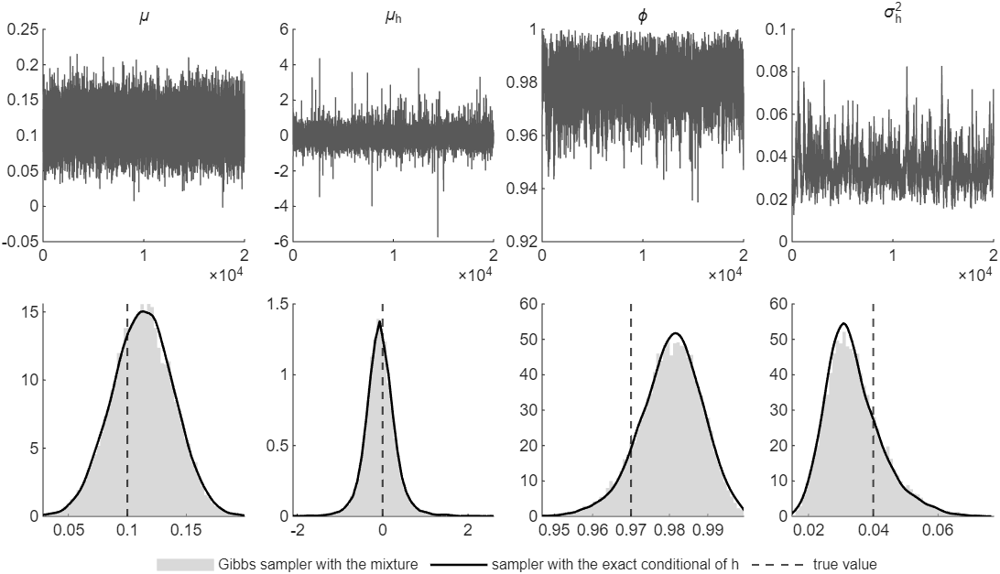

# How to Estimate a Stochastic Volatility Model by Gibbs Sampling

*Code: [`guide.m`](guide.m), with [`ssm.ksc_ar1_mean`](../../core/+ssm/ksc_ar1_mean.m),
[`ssm.inefficiency_factor`](../../core/+ssm/inefficiency_factor.m),
[`ssm.mcse`](../../core/+ssm/mcse.m), [`ssm.geweke`](../../core/+ssm/geweke.m) and
[`ssm.armh`](../../core/+ssm/armh.m). Method:
[Kim, Shephard and Chib (1998)](../../CITING.md#kim-shephard-and-chib-1998),
[Del Negro and Primiceri (2015)](../../CITING.md#del-negro-and-primiceri-2015),
[Chan and Grant (2016)](../../CITING.md#chan-and-grant-2016b),
[Geweke (1992)](../../CITING.md#geweke-1992) and [Chan (2027)](../../CITING.md#chan-2027).*

We estimate the stochastic volatility (SV) model of
[How to Draw the Log-Volatilities of a Stochastic Volatility Model](../sv_states/) by Gibbs
sampling, on the data of that guide. That guide holds the mean $`\mu`$ and the parameters
$`\mu_h`$, $`\phi`$ and $`\sigma_h^2`$ of the log-volatility at their true values. Here we
estimate them along with the log-volatilities. Each iteration of the sampler draws the
log-volatilities by the auxiliary mixture sampler of the first guide. It then draws three
parameters from standard distributions and $`\phi`$ by a Metropolis-Hastings step.

To draw the figure first, run from the root of the repository:

```matlab
run guides/sv_gibbs/guide.m
```

It takes about 30 seconds on the machine that produced this page.

## The Model and Its Priors

The model is that of the first guide,

```math
y_t = \mu + \mathrm{e}^{h_t/2}\varepsilon_t, \qquad \varepsilon_t \sim \mathcal{N}(0, 1), \qquad\qquad h_t = \mu_h + \phi(h_{t-1} - \mu_h) + u_t, \qquad u_t \sim \mathcal{N}(0, \sigma_h^2),
```

with $`h_1 \sim \mathcal{N}(\mu_h, \sigma_h^2/(1 - \phi^2))`$ and $`\mu`$, $`\mu_h`$, $`\phi`$ and
$`\sigma_h^2`$ unknown. We follow Chan and Grant (2016) to set the priors:

```math
\mu \sim \mathcal{N}(0, 10), \qquad \mu_h \sim \mathcal{N}(1, 10), \qquad \phi \sim \mathcal{TN}_{(-1,1)}(0.97, 0.1^2), \qquad \sigma_h^2 \sim \mathcal{IG}(5, 0.16),
```

where $`\mathcal{TN}_{(-1,1)}`$ is the normal distribution truncated to $`(-1, 1)`$ and
$`\mathcal{IG}(\nu, S)`$ is the inverse-gamma distribution with shape $`\nu`$ and scale $`S`$.
The prior mean of $`\sigma_h^2`$ is $`0.16/4 = 0.04`$. In general notation the priors are
$`\mu \sim \mathcal{N}(\mu_0, V_\mu)`$, $`\mu_h \sim \mathcal{N}(\mu_{h0}, V_{\mu_h})`$,
$`\phi \sim \mathcal{TN}_{(-1,1)}(\phi_0, V_\phi)`$ and
$`\sigma_h^2 \sim \mathcal{IG}(\nu_h, S_h)`$. The data are those of the first guide: $`T = 1000`$
observations in percent, generated with $`\mu = 0.1`$, $`\mu_h = 0`$, $`\phi = 0.97`$ and
$`\sigma_h^2 = 0.04`$.

## Step 1: Split the Unknowns into Blocks

The unknowns are $`\mu`$, the log-volatilities $`\mathbf{h} = (h_1, \ldots, h_T)'`$, the mixture
indicators $`\mathbf{s}`$ of the first guide, and $`\mu_h`$, $`\phi`$ and $`\sigma_h^2`$. The
sampler cycles through five blocks:

1. $`(\mu \mid \mathbf{y}, \mathbf{h})`$, a normal distribution;
2. $`(\mathbf{s} \mid \mathbf{y}, \mu, \mathbf{h})`$ and then
   $`(\mathbf{h} \mid \mathbf{y}, \mu, \mathbf{s}, \mu_h, \phi, \sigma_h^2)`$, the mixture step of
   the first guide;
3. $`(\sigma_h^2 \mid \mathbf{h}, \mu_h, \phi)`$, an inverse-gamma distribution;
4. $`(\phi \mid \mathbf{h}, \mu_h, \sigma_h^2)`$, by a Metropolis-Hastings step;
5. $`(\mu_h \mid \mathbf{h}, \phi, \sigma_h^2)`$, a normal distribution.

Block 1 draws $`\mu`$ given $`\mathbf{h}`$ and not given the indicators. Given $`h_t`$, the
observation $`y_t`$ is normal with mean $`\mu`$ and known variance $`\mathrm{e}^{h_t}`$, so the
distribution of $`\mu`$ is normal. Given the indicators as well, $`\mu`$ enters through
$`y_t^* = \log\big((y_t - \mu)^2 + c\big)`$, and its distribution has no standard form. Block 2
then draws the indicators afresh, from the $`y_t^*`$ that the new $`\mu`$ gives. Drawing the
indicators immediately before $`\mathbf{h}`$ follows Del Negro and Primiceri (2015). The parameters
of the log-volatility enter only the state equation, so given $`\mathbf{h}`$ they do not depend on
$`\mathbf{y}`$ or on the indicators.

## Step 2: Derive the Conditional Distributions

**The mean.** Given $`\mathbf{h}`$, the model is a regression of $`y_t`$ on a constant with known
variances $`\mathrm{e}^{h_t}`$. The normal prior is conjugate:

```math
(\mu \mid \mathbf{y}, \mathbf{h}) \sim \mathcal{N}\big(K_\mu^{-1}c_\mu,\; K_\mu^{-1}\big), \qquad K_\mu = \frac{1}{V_\mu} + \sum_{t=1}^{T}\mathrm{e}^{-h_t}, \qquad c_\mu = \frac{\mu_0}{V_\mu} + \sum_{t=1}^{T}\mathrm{e}^{-h_t}y_t.
```

**The variance of the log-volatility.** Given $`\mathbf{h}`$, $`\mu_h`$ and $`\phi`$, the state
errors are known: $`u_1 = \sqrt{1 - \phi^2}(h_1 - \mu_h)`$, scaled to variance $`\sigma_h^2`$, and
$`u_t = h_t - \mu_h - \phi(h_{t-1} - \mu_h)`$ for $`t > 1`$. The inverse-gamma prior is conjugate:

```math
(\sigma_h^2 \mid \mathbf{h}, \mu_h, \phi) \sim \mathcal{IG}\Big(\nu_h + \frac{T}{2},\; S_h + \frac{1}{2}\sum_{t=1}^{T}u_t^2\Big).
```

**The persistence.** The state equations for $`t > 1`$ form a regression of $`h_t - \mu_h`$ on
$`h_{t-1} - \mu_h`$ with coefficient $`\phi`$. Combined with the prior, they give the truncated
normal density $`q(\phi)`$ of $`\mathcal{TN}_{(-1,1)}(\hat{\phi}, K_\phi^{-1})`$, with

```math
K_\phi = \frac{1}{V_\phi} + \frac{1}{\sigma_h^2}\sum_{t=2}^{T}(h_{t-1} - \mu_h)^2, \qquad \hat{\phi} = K_\phi^{-1}\Big(\frac{\phi_0}{V_\phi} + \frac{1}{\sigma_h^2}\sum_{t=2}^{T}(h_{t-1} - \mu_h)(h_t - \mu_h)\Big).
```

The first state equation also depends on $`\phi`$, through the variance
$`\sigma_h^2/(1 - \phi^2)`$ of $`h_1`$. The conditional density of $`\phi`$ is therefore
proportional to $`g(\phi)q(\phi)`$ on $`(-1, 1)`$, with

```math
g(\phi) = \sqrt{1 - \phi^2}\,\exp\Big(-\frac{(1 - \phi^2)(h_1 - \mu_h)^2}{2\sigma_h^2}\Big).
```

An independence-chain Metropolis-Hastings step draws a candidate $`\phi^*`$ from $`q`$ and accepts
it with probability $`\min\{1, g(\phi^*)/g(\phi)\}`$. The factor $`g`$ comes from one period only,
so the acceptance rate is high.

**The mean of the log-volatility.** Written as
$`h_1 = \mu_h + \sqrt{\sigma_h^2/(1 - \phi^2)}\,e_1`$ with $`e_1 \sim \mathcal{N}(0, 1)`$, and
$`h_t - \phi h_{t-1} = (1 - \phi)\mu_h + u_t`$, the state equations form a regression in $`\mu_h`$
with known variances. With the normal prior,

```math
(\mu_h \mid \mathbf{h}, \phi, \sigma_h^2) \sim \mathcal{N}\big(K_{\mu_h}^{-1}c_{\mu_h},\; K_{\mu_h}^{-1}\big), \qquad K_{\mu_h} = \frac{1}{V_{\mu_h}} + \frac{1 - \phi^2 + (T - 1)(1 - \phi)^2}{\sigma_h^2},
```

```math
c_{\mu_h} = \frac{\mu_{h0}}{V_{\mu_h}} + \frac{1}{\sigma_h^2}\Big((1 - \phi^2)h_1 + (1 - \phi)\sum_{t=2}^{T}(h_t - \phi h_{t-1})\Big).
```

## Step 3: Write the Loop

```matlab
mu0 = 0; Vmu = 10;                                      % mu ~ N(mu0, Vmu)
muh0 = 1; Vmuh = 10;                                    % mu_h ~ N(muh0, Vmuh)
phi0 = .97; Vphi = .1^2;                                % phi ~ TN(phi0, Vphi) on (-1, 1)
nuh = 5; Sh = .16;                                      % sigma_h^2 ~ IG(nuh, Sh)
offset = 1e-4;
nsim = 20000; burnin = 1000;
muh = log(var(y)); phi = .98; sig2h = .04;              % starting values
h = muh*ones(T,1);
store_theta = zeros(nsim, 4); nacc = 0;
store_h = zeros(T, nsim/10);
for isim = 1:burnin + nsim
    Kmu = 1/Vmu + sum(exp(-h));                         % K_mu = 1/V_mu + sum_t e^{-h_t}
    mu = (mu0/Vmu + exp(-h)'*y)/Kmu + randn/sqrt(Kmu);  % mu ~ N(c_mu/K_mu, 1/K_mu)

    ystar = log((y - mu).^2 + offset);  % s, then h: guides/sv_states
    h = ssm.ksc_ar1_mean(ystar, h, muh, phi, sig2h);

    hc = h - muh;                                          % h_t - mu_h
    u = [sqrt(1 - phi^2)*hc(1); hc(2:T) - phi*hc(1:T-1)];  % the state errors u_t
    sig2h = 1/gamrnd(nuh + T/2, 1/(Sh + u'*u/2));          % IG(nu_h + T/2, S_h + u'u/2)

    Kphi = 1/Vphi + hc(1:T-1)'*hc(1:T-1)/sig2h;             % K_phi and phihat of the proposal
    phihat = (phi0/Vphi + hc(1:T-1)'*hc(2:T)/sig2h)/Kphi;
    phic = 2;
    while abs(phic) >= 1, phic = phihat + randn/sqrt(Kphi); end
    g = @(x) .5*log(1 - x^2) - .5*(1 - x^2)*hc(1)^2/sig2h;  % log g(phi)
    if g(phic) - g(phi) > log(rand)
        phi = phic;
        nacc = nacc + (isim > burnin);
    end

    Kmuh = 1/Vmuh + (1 - phi^2 + (T-1)*(1 - phi)^2)/sig2h;  % mu_h given h, phi and sigma_h^2
    cmuh = muh0/Vmuh + ((1 - phi^2)*h(1) + (1 - phi)*sum(h(2:T) - phi*h(1:T-1)))/sig2h;
    muh = cmuh/Kmuh + randn/sqrt(Kmuh);

    if isim > burnin
        store_theta(isim - burnin, :) = [mu muh phi sig2h];
        if mod(isim - burnin, 10) == 0, store_h(:, (isim - burnin)/10) = h; end
    end
end
```

The chain starts from the starting values of Chan and Grant (2016): $`\mu_h`$ equal to the log of
the sample variance of $`y_t`$, $`\phi = 0.98`$ and $`\sigma_h^2 = 0.04`$. The path of the
log-volatilities starts flat, at $`\mu_h`$. The loop draws the candidate $`\phi^*`$ from the
truncated normal distribution by drawing from the normal distribution until the draw falls in
$`(-1, 1)`$. The first 1,000 iterations are discarded as burn-in.

## Step 4: Check the Chain

Figure 1 shows the draws of the four parameters after the burn-in. The draws of $`\mu`$ and
$`\mu_h`$ are nearly independent, while those of $`\phi`$ and $`\sigma_h^2`$ are strongly
correlated. The draws of $`\mu_h`$ have spikes in both directions. The three farthest from 0, at
$`-5.76`$, 4.37 and $`-4.00`$, occur with $`\phi`$ between 0.9967 and 0.9993. There the state
equation carries little information about the mean of the log-volatility. Draws of $`\phi`$ above
0.995 make up 367 of the 20,000. The sampler draws $`\phi`$ and $`\sigma_h^2`$ given the path of
the log-volatilities, and the path given $`\phi`$ and $`\sigma_h^2`$. The two depend strongly on
each other in the posterior. [`ssm.inefficiency_factor`](../../core/+ssm/inefficiency_factor.m)
estimates the long-run variance of the draws with Bartlett weights up to a truncation lag $`L`$.
That lag must reach past the lag at which the autocorrelations die out. For $`\phi`$ and
$`\sigma_h^2`$ the inefficiency factors grow up to $`L = 200`$ and then stay put:

| Truncation lag $`L`$ | 50 | 100 | 200 | 400 |
|---|---|---|---|---|
| $`\phi`$ | 12.0 | 17.0 | 20.9 | 21.7 |
| $`\sigma_h^2`$ | 33.0 | 47.7 | 57.9 | 58.6 |

With $`L = 200`$, the 20,000 draws of $`\sigma_h^2`$ carry about as much information as 350
independent draws. The Monte Carlo standard errors from [`ssm.mcse`](../../core/+ssm/mcse.m)
measure how far each posterior mean can be from its value in an infinitely long chain.

| | True value | Posterior mean | 90% interval | Inefficiency factor | Monte Carlo standard error |
|---|---|---|---|---|---|
| $`\mu`$ | 0.1 | 0.1129 | (0.0696, 0.1557) | 1.5 | 0.0002 |
| $`\mu_h`$ | 0 | -0.0545 | (-0.6068, 0.5296) | 1.2 | 0.0030 |
| $`\phi`$ | 0.97 | 0.9800 | (0.9653, 0.9925) | 20.9 | 0.0003 |
| $`\sigma_h^2`$ | 0.04 | 0.0346 | (0.0220, 0.0519) | 57.9 | 0.0005 |

All four true values lie inside their 90 percent intervals. The candidate $`\phi^*`$ is accepted
in 92.5 percent of the iterations.

Geweke's (1992) diagnostic compares the mean of the first 10 percent of the draws with the mean of
the last half. It divides the difference by its standard error.
[`ssm.geweke`](../../core/+ssm/geweke.m) returns it, and it is approximately standard normal if
the chain has converged. Its standard error needs the same truncation lag. With $`L = 200`$ the
four values are 0.05, 0.71, $`-1.43`$ and 1.29, all inside $`\pm 1.96`$.



*Figure 1: Top, the 20,000 draws of $`\mu`$, $`\mu_h`$, $`\phi`$ and $`\sigma_h^2`$ kept after the
burn-in, in the order the sampler makes them. Bottom, their histograms over the central 99.9
percent of the draws, the posterior densities from the sampler of How We Check It, and the true
values.*

The volatility estimated with the parameters unknown is close to that of the first guide. The 90
percent intervals of $`\mathrm{e}^{h_t/2}`$ are 0.64 wide on average, against 0.66 with the
parameters known. They contain the true volatility in 880 of the 1,000 periods.

## How We Check It

<details>
<summary>The posterior from a second sampler, which draws the log-volatilities from their exact
conditional distribution</summary>

The sampler of Chan and Grant (2016) has the same blocks, except for $`\mathbf{h}`$. It draws
$`\mathbf{h}`$ from its exact conditional distribution, by the accept-reject Metropolis-Hastings
step of [How to Draw the Log-Volatilities of a Stochastic Volatility Model](../sv_states/). It
does not use the mixture. `guide.m` runs it on the same data with the same priors, for 20,000
draws after a burn-in of 1,000, starting the log-volatilities at the mode. Its Metropolis-Hastings
step takes the candidate path in 70.4 percent of the iterations.

The posterior means of the two samplers differ by $`-1.2`$, $`-0.6`$, $`-0.9`$ and 0.9 Monte Carlo
standard errors for $`\mu`$, $`\mu_h`$, $`\phi`$ and $`\sigma_h^2`$. Their posterior standard
deviations differ by at most 6.3 percent.

</details>

## Adapt It Yourself

The book *Bayesian Macroeconometrics* (Chan, 2027) lets the log-volatility follow a random walk,
$`h_t = h_{t-1} + u_t`$ with $`u_t \sim \mathcal{N}(0, \sigma_h^2)`$, from an unknown initial value
$`h_0 \sim \mathcal{N}(a_0, b_0)`$. Which blocks change?

<details>
<summary>Answer</summary>

The blocks of $`\phi`$ and $`\mu_h`$ go, and $`h_0`$ gets a block of its own. Given $`h_0`$, the
mixture step uses the random-walk state equation of the Adapt It Yourself answer in
[How to Draw the Log-Volatilities of a Stochastic Volatility Model](../sv_states/), which
[`ssm.ksc_rw_h0`](../../core/+ssm/ksc_rw_h0.m) implements. The state errors become
$`u_t = h_t - h_{t-1}`$ with the current $`h_0`$, and $`\sigma_h^2`$ keeps its inverse-gamma form.
The initial value enters only the first state equation, $`h_1 = h_0 + u_1`$, so

$`\displaystyle (h_0 \mid h_1, \sigma_h^2) \sim \mathcal{N}\big(K_{h_0}^{-1}c_{h_0},\; K_{h_0}^{-1}\big), \qquad K_{h_0} = \frac{1}{b_0} + \frac{1}{\sigma_h^2}, \qquad c_{h_0} = \frac{a_0}{b_0} + \frac{h_1}{\sigma_h^2}.`$

```matlab
a0 = 0; b0 = 10;          % h_0 ~ N(a0, b0)
nuh_rw = 5; Sh_rw = .04;  % sigma_h^2 ~ IG(nuh_rw, Sh_rw)
H = ssm.diffmat(T);
h0 = log(var(y_rw)); sig2h = .01; h = h0*ones(T,1);
store_rw = zeros(nsim, 4);
for isim = 1:burnin + nsim
    Kmu = 1/Vmu + sum(exp(-h));
    mu = (mu0/Vmu + exp(-h)'*y_rw)/Kmu + randn/sqrt(Kmu);

    h = ssm.ksc_rw_h0(log((y_rw - mu).^2 + offset), h, sig2h, h0);  % s, then h, given h_0

    u = H*h - [h0; zeros(T-1,1)];  % h_t - h_{t-1}, with h_0
    sig2h = 1/gamrnd(nuh_rw + T/2, 1/(Sh_rw + u'*u/2));

    Kh0 = 1/b0 + 1/sig2h;  % h_0 given h_1 and sigma_h^2
    h0 = (a0/b0 + h(1)/sig2h)/Kh0 + randn/sqrt(Kh0);

    if isim > burnin, store_rw(isim - burnin, :) = [mu sig2h h0 h(1)]; end
end
```

`guide.m` runs this sampler on data generated from the random walk, with $`T = 1000`$,
$`\mu = 0.1`$, $`h_0 = 0`$ and $`\sigma_h^2 = 0.01`$. The posterior mean of $`\sigma_h^2`$ is
0.0112, with 90 percent interval (0.0067, 0.0177). The sampler with the exact conditional
distribution of $`\mathbf{h}`$ gives the same posterior. Under the two samplers, the posterior
means of $`\mu`$, $`\sigma_h^2`$, $`h_0`$ and $`h_1`$ differ by at most 2.6 Monte Carlo standard
errors.

</details>

## Next

[How to Add Student-t Errors to a Stochastic Volatility Model](../sv_t/) lets the errors have
heavier tails than the normal distribution. Among the examples,
[ex08](../../examples/ex08_sv_ma_t.m) runs a sampler with the same blocks for the log-volatility on
daily silver returns.

## Using This Method in Your Research

The sampler draws the log-volatilities by the auxiliary mixture sampler of Kim, Shephard and Chib
(1998), with the model and priors of Chan and Grant (2016). The inefficiency factors and the
convergence diagnostic are those of Geweke (1992), and Chan (2027) gives the textbook treatment of
the sampler. [`CITING.md`](../../CITING.md) lists the paper behind each function of the toolkit and
how to cite the toolkit itself.

## References

Chan, J. C. C. (2027). *Bayesian Macroeconometrics: Methods and Applications*. Chapman &
Hall/CRC. [Code repository](https://github.com/joshuaccchan/bayesian-macroeconometrics)

Chan, J. C. C. and Grant, A. L. (2016). Modeling Energy Price Dynamics: GARCH versus Stochastic
Volatility. *Energy Economics*, 54: 182-189.
[doi:10.1016/j.eneco.2015.12.003](https://doi.org/10.1016/j.eneco.2015.12.003)

Geweke, J. (1992). Evaluating the Accuracy of Sampling-Based Approaches to the Calculation of
Posterior Moments. In J. M. Bernardo, J. O. Berger, A. P. Dawid and A. F. M. Smith (Eds),
*Bayesian Statistics 4*, 169-193. Oxford University Press.
[doi:10.1093/oso/9780198522669.003.0010](https://doi.org/10.1093/oso/9780198522669.003.0010)

Kim, S., Shephard, N. and Chib, S. (1998). Stochastic Volatility: Likelihood Inference and
Comparison with ARCH Models. *Review of Economic Studies*, 65(3): 361-393.
[doi:10.1111/1467-937X.00050](https://doi.org/10.1111/1467-937X.00050)
