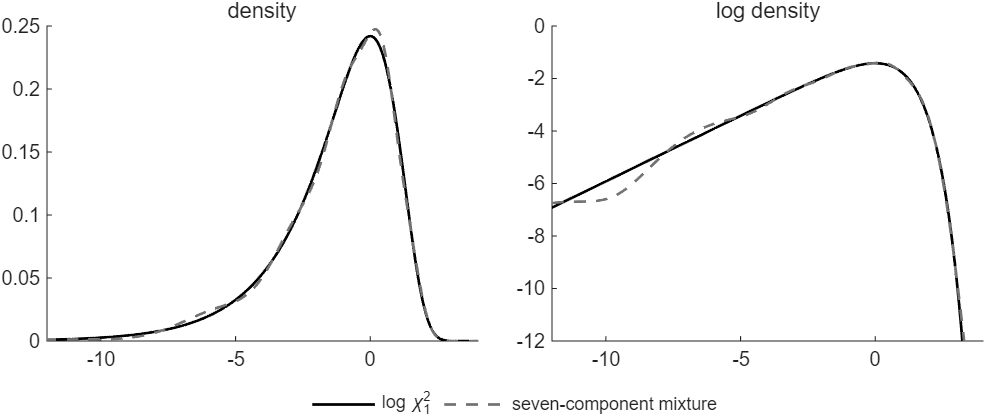
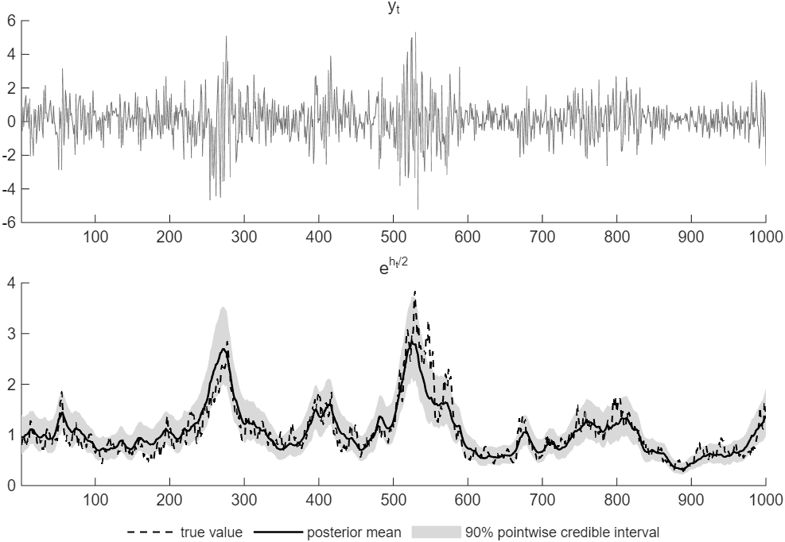

# How to Draw the Log-Volatilities of a Stochastic Volatility Model

*Code: [`guide.m`](guide.m), with [`ssm.ksc_ar1_mean`](../../core/+ssm/ksc_ar1_mean.m),
[`ssm.simulate_states`](../../core/+ssm/simulate_states.m),
[`ssm.diffmat`](../../core/+ssm/diffmat.m) and [`ssm.armh`](../../core/+ssm/armh.m). Method:
[Kim, Shephard and Chib (1998)](../../CITING.md#kim-shephard-and-chib-1998),
[Chan and Jeliazkov (2009)](../../CITING.md#chan-and-jeliazkov-2009),
[Chan (2017)](../../CITING.md#chan-2017) and [Chan (2027)](../../CITING.md#chan-2027).*

In a stochastic volatility (SV) model, the variance of the data changes over time, and its
logarithm, the log-volatility, is a state. The data depend on the state through its exponential,
so the model is nonlinear, and the recipe of
[How to Draw the States of an Unobserved Components Model](../uc_states/) does not apply directly.
The auxiliary mixture sampler of Kim, Shephard and Chib (1998) approximates the model in two
steps. It takes logs of the squared data, which makes the model linear. It then approximates the
distribution of the new error by a mixture of seven normal distributions. Given the mixture
component of each period, the model is linear and Gaussian, and the precision sampler draws the
whole path of the log-volatilities at once. In this guide the parameters are known;
[How to Estimate a Stochastic Volatility Model by Gibbs Sampling](../sv_gibbs/) draws them as well.

To draw the figures first, run from the root of the repository:

```matlab
run guides/sv_states/guide.m
```

It takes about 15 seconds on the machine that produced this page.

## The Stochastic Volatility Model

The model is

```math
y_t = \mu + \mathrm{e}^{h_t/2}\varepsilon_t, \qquad \varepsilon_t \sim \mathcal{N}(0, 1), \qquad\qquad h_t = \mu_h + \phi(h_{t-1} - \mu_h) + u_t, \qquad u_t \sim \mathcal{N}(0, \sigma_h^2),
```

for $`t = 1, \ldots, T`$, where $`|\phi| < 1`$ and the first log-volatility comes from the
stationary distribution, $`h_1 \sim \mathcal{N}(\mu_h, \sigma_h^2/(1 - \phi^2))`$. The variance of
$`y_t`$ given $`h_t`$ is $`\mathrm{e}^{h_t}`$, and its standard deviation $`\mathrm{e}^{h_t/2}`$ is
the volatility. The log-volatility reverts to its mean $`\mu_h`$ at a rate set by $`\phi`$, and
$`\sigma_h^2`$ sets how much it moves from one period to the next. The states are the
log-volatilities $`\mathbf{h} = (h_1, \ldots, h_T)'`$, one per period.

We generate $`T = 1000`$ observations in percent, as for a daily return, with $`\mu = 0.1`$,
$`\mu_h = 0`$, $`\phi = 0.97`$ and $`\sigma_h^2 = 0.04`$. The true volatility ranges from 0.29 to
3.83.

## Step 1: Take Logs of the Squared Data

Subtract the mean, square, and take logs:

```math
y_t^* = \log\big((y_t - \mu)^2 + c\big) = h_t + \varepsilon_t^*, \qquad \varepsilon_t^* = \log \varepsilon_t^2,
```

where the second equality holds for $`c = 0`$. The measurement equation is now linear in
$`h_t`$. Its error $`\varepsilon_t^*`$ is the log of a $`\chi^2_1`$ variable, whose distribution
has mean $`-1.2704`$, variance $`\pi^2/2 \approx 4.93`$ and a long left tail (Figure 1).

The offset $`c = 10^{-4}`$ keeps the log finite when $`y_t = \mu`$. It must be small relative to
$`(y_t - \mu)^2`$, which is why the data are in percent. On our data the offset moves $`y_t^*`$ by
more than 0.1 in 28 of the 1,000 periods. With the same data in decimals, divided by 100, it would
do so in 976 periods, and the median shift would be 1.33. In code:

```matlab
offset = 1e-4;
ystar = log((y - mu).^2 + offset);  % y*_t = log((y_t - mu)^2 + c)
```

## Step 2: Approximate the Error by a Mixture of Normals

Kim, Shephard and Chib (1998) approximate the density of $`\varepsilon_t^*`$ by a mixture of seven
normal densities,

```math
f(\varepsilon_t^*) \approx \sum_{i=1}^{7} p_i\, f_{\mathcal{N}}(\varepsilon_t^*;\, \mu_i - 1.2704,\, \sigma_i^2),
```

with the fixed weights $`p_i`$, means and variances below. The mixture follows the density closely
(Figure 1, left). On the log scale, the two differ most in the far left tail (Figure 1, right).

| $`i`$ | 1 | 2 | 3 | 4 | 5 | 6 | 7 |
|---|---|---|---|---|---|---|---|
| $`p_i`$ | 0.00730 | 0.10556 | 0.00002 | 0.04395 | 0.34001 | 0.24566 | 0.25750 |
| $`\mu_i`$ | -10.12999 | -3.97281 | -8.56686 | 2.77786 | 0.61942 | 1.79518 | -1.08819 |
| $`\sigma_i^2`$ | 5.79596 | 2.61369 | 5.17950 | 0.16735 | 0.64009 | 0.34023 | 1.26261 |



*Figure 1: The density of $`\log\chi^2_1`$ and the seven-component mixture of Kim, Shephard and
Chib (1998), on a linear and on a log scale.*

A mixture can be written with an indicator $`s_t \in \{1, \ldots, 7\}`$ for the component of
period $`t`$, with $`\Pr(s_t = i) = p_i`$. Given $`s_t = i`$, the error $`\varepsilon_t^*`$ is
normal with mean $`\mu_i - 1.2704`$ and variance $`\sigma_i^2`$. Stacked over $`t`$, the
measurement equation is then

```math
\mathbf{y}^* = \mathbf{h} + \mathbf{d}_{\mathbf{s}} + \mathbf{e}, \qquad \mathbf{e} \sim \mathcal{N}(\mathbf{0}, \boldsymbol{\Sigma}_{\mathbf{s}}),
```

with $`\mathbf{d}_{\mathbf{s}} = (\mu_{s_1} - 1.2704, \ldots, \mu_{s_T} - 1.2704)'`$ and
$`\boldsymbol{\Sigma}_{\mathbf{s}} = \mathrm{diag}(\sigma_{s_1}^2, \ldots, \sigma_{s_T}^2)`$. Given
the indicators $`\mathbf{s} = (s_1, \ldots, s_T)'`$, the model is linear and Gaussian.

The state equation, written as $`h_1 - \mu_h = u_1`$ and
$`h_t - \phi h_{t-1} = (1 - \phi)\mu_h + u_t`$ for $`t > 1`$, stacks into
$`\mathbf{H}_\phi\mathbf{h} = \mathbf{H}_\phi\mu_h\mathbf{1} + \mathbf{u}`$. Here
$`\mathbf{u} \sim \mathcal{N}(\mathbf{0}, \mathbf{S})`$ with
$`\mathbf{S} = \mathrm{diag}(\sigma_h^2/(1 - \phi^2), \sigma_h^2, \ldots, \sigma_h^2)`$, and
$`\mathbf{H}_\phi = \mathbf{I}_T - \phi\mathbf{L}`$ has ones on the diagonal and $`-\phi`$ just
below it; `ssm.diffmat(T, phi)` returns it. The recipe of
[How to Draw the States of an Unobserved Components Model](../uc_states/) adds the contributions of
the two equations. With the prior precision
$`\mathbf{P} = \mathbf{H}_\phi'\mathbf{S}^{-1}\mathbf{H}_\phi`$ of $`\mathbf{h}`$,

```math
\mathbf{K} = \mathbf{P} + \boldsymbol{\Sigma}_{\mathbf{s}}^{-1}, \qquad \mathbf{c} = \mathbf{P}\mu_h\mathbf{1} + \boldsymbol{\Sigma}_{\mathbf{s}}^{-1}(\mathbf{y}^* - \mathbf{d}_{\mathbf{s}}).
```

The indicators in turn depend on $`\mathbf{h}`$. Given $`\mathbf{h}`$, they are independent across
periods, and $`s_t`$ takes the value $`i`$ with probability proportional to
$`p_i f_{\mathcal{N}}(y_t^*;\, h_t + \mu_i - 1.2704,\, \sigma_i^2)`$. One draw of the indicators
and then of $`\mathbf{h}`$, given the current path `h`, is in code:

```matlab
pj = [.0073 .10556 .00002 .04395 .34001 .24566 .2575];                        % p_i
mj = [-10.12999 -3.97281 -8.56686 2.77786 .61942 1.79518 -1.08819] - 1.2704;  % mu_i - 1.2704
s2j = [5.79596 2.61369 5.17950 .16735 .64009 .34023 1.26261];                 % sigma_i^2

Hphi = ssm.diffmat(T, phi);                             % H_phi = I - phi*L
iS = spdiags([1 - phi^2; ones(T-1,1)]/sig2h, 0, T, T);  % S^{-1}
P = Hphi'*iS*Hphi;                                      % P = H_phi'*S^{-1}*H_phi

q = pj.*normpdf(ystar, h + mj, sqrt(s2j));           % p_i*N(y*_t; h_t + mu_i - 1.2704, sigma_i^2)
s = 1 + sum(rand(T,1) > cumsum(q./sum(q,2), 2), 2);  % s_t from its seven probabilities
K = P + spdiags(1./s2j(s)', 0, T, T);                % K = P + Sigma_s^{-1}
c = P*(muh*ones(T,1)) + (ystar - mj(s)')./s2j(s)';   % c = P*mu_h*1 + Sigma_s^{-1}*(y* - d_s)
h = ssm.simulate_states(K, c);
```

The variable `offset` of Step 1 is the scalar $`c`$; the vector `c` here is $`\mathbf{c}`$.
$`\mathbf{K}`$ is tridiagonal. At this draw, with the indicators of the first four periods equal
to 5, 5, 5 and 7, its top left corner is

```math
\begin{bmatrix} 26.56 & -24.25 & 0 & 0 \\ -24.25 & 50.08 & -24.25 & 0 \\ 0 & -24.25 & 50.08 & -24.25 \\ 0 & 0 & -24.25 & 49.31 \end{bmatrix}.
```

$`\mathbf{P}`$ contributes $`1/\sigma_h^2 = 25`$ to the first and last diagonal entries,
$`(1 + \phi^2)/\sigma_h^2 = 48.52`$ to the others and $`-\phi/\sigma_h^2 = -24.25`$ next to the
diagonal. The rest of each diagonal entry is $`1/\sigma_{s_t}^2`$, here $`1/0.64009 = 1.56`$ and
$`1/1.26261 = 0.79`$. [`ssm.ksc_ar1_mean`](../../core/+ssm/ksc_ar1_mean.m) takes both steps in one
call:

```matlab
[h, s] = ssm.ksc_ar1_mean(ystar, h, muh, phi, sig2h);  % s given h, then h given s
```

## Step 3: Alternate the Indicators and the Log-Volatilities

In [How to Draw the States of an Unobserved Components Model](../uc_states/), the states are drawn
independently from a Gaussian distribution. Here each draw of $`\mathbf{h}`$ is Gaussian only given
the indicators, and the indicators depend on the previous draw of $`\mathbf{h}`$. The draws
therefore form a Markov chain, a Gibbs sampler with two blocks. The chain needs a starting path and
a burn-in, and its draws are correlated:

```matlab
nsim = 5000; burnin = 500;
h = muh*ones(T,1);                                    % the starting path
store_h = zeros(T, nsim);
for isim = 1:burnin + nsim
    h = ssm.ksc_ar1_mean(ystar, h, muh, phi, sig2h);  % s given h, then h given s
    if isim > burnin
        store_h(:, isim - burnin) = h;
    end
end
```

With Bartlett weights up to lag 100, the inefficiency factors of the $`h_t`$ have median 3.4 and
maximum 5.2, so the chain mixes well. Figure 2 shows the posterior mean of the volatility
$`\mathrm{e}^{h_t/2}`$ and its 90 percent intervals, which follow the true volatility. The
intervals are 0.66 wide on average.



*Figure 2: The SV model on generated data, with $`T = 1000`$, $`\mu = 0.1`$, $`\mu_h = 0`$,
$`\phi = 0.97`$ and $`\sigma_h^2 = 0.04`$. Top, the data. Bottom, the true volatility
$`\mathrm{e}^{h_t/2}`$ and its posterior mean with 90 percent pointwise credible intervals, from
5,000 draws of the mixture sampler.*

## Step 4: Draw from the Exact Conditional Distribution

The draws of Step 3 come from the posterior of the mixture model, which approximates the SV model.
The exact conditional density of $`\mathbf{h}`$ has the log

```math
\log p(\mathbf{h} \mid \mathbf{y}) = -\frac{1}{2}(\mathbf{h} - \mu_h\mathbf{1})'\mathbf{P}(\mathbf{h} - \mu_h\mathbf{1}) - \frac{1}{2}\sum_{t=1}^{T} h_t - \frac{1}{2}\sum_{t=1}^{T}(y_t - \mu)^2\mathrm{e}^{-h_t} + \text{const}.
```

The last sum makes the density non-Gaussian. The density is concave, and its negative Hessian

```math
\mathbf{P} + \mathrm{diag}\Big(\frac{1}{2}(y_1 - \mu)^2\mathrm{e}^{-h_1}, \ldots, \frac{1}{2}(y_T - \mu)^2\mathrm{e}^{-h_T}\Big)
```

is tridiagonal. The accept-reject Metropolis-Hastings step of Chan (2017) proposes from a Gaussian
centered at the mode, whose precision is the negative Hessian there. It screens the candidates by
accept-reject sampling and then corrects with a Metropolis-Hastings step, so its draws come from
the exact conditional distribution. Chan and Grant (2016) draw $`\mathbf{h}`$ this way.
[`ssm.armh`](../../core/+ssm/armh.m) takes one step, given the log density and a function that
returns its gradient and negative Hessian:

```matlab
e2 = (y - mu).^2;                                                     % no offset here
logf = @(x) -.5*(x - muh)'*P*(x - muh) - .5*sum(x) - .5*exp(-x)'*e2;  % log p(h | y) + const
gradK = @(x) deal(-P*(x - muh) - .5 + .5*e2.*exp(-x), ...             % the gradient of logf
    P + spdiags(.5*e2.*exp(-x), 0, T, T));                            % and its negative Hessian
h = ssm.mode_newton(muh*ones(T,1), gradK);                            % start at the mode
store_hx = zeros(T, nsim); nacc = 0;
for isim = 1:burnin + nsim
    [h, acc] = ssm.armh(h, logf, gradK, 'ForceAccept', isim == 1);
    if isim > burnin
        store_hx(:, isim - burnin) = h;
        nacc = nacc + acc;
    end
end
```

The chain starts at the mode, which [`ssm.mode_newton`](../../core/+ssm/mode_newton.m) finds, and
the first candidate is accepted whatever the Metropolis-Hastings ratio. A start far from the mode
can leave the chain rejecting every candidate. The Metropolis-Hastings step takes the candidate in
69 percent of the sweeps. The inefficiency factors of the $`h_t`$ have median 4.6 and maximum
14.1.

The two samplers give nearly the same posterior. The posterior means of $`\mathrm{e}^{h_t/2}`$
differ by at most 0.061, or 0.25 posterior standard deviations. The differences are small but
systematic. In 341 of the 1,000 periods they exceed two Monte Carlo standard errors. Averaged over
all periods, the two put $`h_t`$ at the same level, 0.0004 apart. In the 41 periods with
$`|y_t - \mu| < 0.05`$, the mixture sampler puts $`h_t`$ 0.020 below the exact sampler. In those
periods $`y_t^*`$ falls in the left tail of $`\log\chi^2_1`$, where the mixture fits least closely
on the log scale (Figure 1, right).

## How We Check It

<details>
<summary>The checks in guide.m</summary>

With the same random numbers, the steps of Step 2 and
[`ssm.ksc_ar1_mean`](../../core/+ssm/ksc_ar1_mean.m) give the same indicators, and their draws of
$`\mathbf{h}`$ differ by at most 3e-16. The mixture has the mean and variance of $`\log\chi^2_1`$:
$`-1.2704`$ and 4.9349, against $`-1.2704`$ and 4.9348. The integral of the absolute difference
between the two densities is 0.036. The log of the mixture density is within 0.23 of the log of
the exact density on $`(-8, 2)`$. On $`(-15, -8)`$ it is up to 0.71 away.

The exact sampler of Step 4 checks the mixture sampler of Step 3 without using the mixture. In
this realization, the 90 percent intervals of Step 3 contain the true volatility in 897 of the
1,000 periods. One realization illustrates the intervals and does not check their coverage.

</details>

## Adapt It Yourself

The book *Bayesian Macroeconometrics* (Chan, 2027) lets the log-volatility follow a random walk,
$`h_t = h_{t-1} + u_t`$ with $`u_t \sim \mathcal{N}(0, \sigma_h^2)`$, from a known initial value
$`h_0`$. How do $`\mathbf{K}`$ and $`\mathbf{c}`$ change?

<details>
<summary>Answer</summary>

Only the state equation changes. Written as $`h_1 - h_0 = u_1`$ and $`h_t - h_{t-1} = u_t`$ for
$`t > 1`$, it stacks into $`\mathbf{H}\mathbf{h} = \tilde{\mathbf{h}}_0 + \mathbf{u}`$ with
$`\mathbf{u} \sim \mathcal{N}(\mathbf{0}, \sigma_h^2\mathbf{I}_T)`$,
$`\tilde{\mathbf{h}}_0 = (h_0, 0, \ldots, 0)'`$ and the first-difference matrix $`\mathbf{H}`$.
So

$`\displaystyle \mathbf{K} = \frac{1}{\sigma_h^2}\mathbf{H}'\mathbf{H} + \boldsymbol{\Sigma}_{\mathbf{s}}^{-1}, \qquad \mathbf{c} = \frac{1}{\sigma_h^2}\mathbf{H}'\tilde{\mathbf{h}}_0 + \boldsymbol{\Sigma}_{\mathbf{s}}^{-1}(\mathbf{y}^* - \mathbf{d}_{\mathbf{s}}).`$

```matlab
H = ssm.diffmat(T);                             % first differences
K = H'*H/sig2h + spdiags(1./s2j(s)', 0, T, T);  % K = H'*H/sigma_h^2 + Sigma_s^{-1}
c = H'*[h0; zeros(T-1,1)]/sig2h ...             % c = H'*htilde_0/sigma_h^2
    + (ystar - mj(s)')./s2j(s)';                %   + Sigma_s^{-1}*(y* - d_s)
```

The indicators are drawn as before. [`ssm.ksc_rw_h0`](../../core/+ssm/ksc_rw_h0.m) takes both
steps for this model. `guide.m` checks the answer against it with the same random numbers; the two
draws agree to within 4e-16.

</details>

## Next

[How to Estimate a Stochastic Volatility Model by Gibbs Sampling](../sv_gibbs/) draws $`\mu`$,
$`\mu_h`$, $`\phi`$ and $`\sigma_h^2`$ along with the log-volatilities. Among the examples,
[ex07](../../examples/ex07_aux_mixture.m) runs the mixture sampler for the random-walk model and
reweights its draws to the exact posterior. [ex08](../../examples/ex08_sv_ma_t.m) adds an MA(1)
term and Student-$`t`$ errors, on daily silver returns.

## Using This Method in Your Research

The auxiliary mixture sampler is the method of Kim, Shephard and Chib (1998). Given the indicators,
it draws the log-volatilities by the precision sampler of Chan and Jeliazkov (2009). The
accept-reject Metropolis-Hastings step is the method of Chan (2017), and Chan (2027) gives the
textbook treatment of both samplers. [`CITING.md`](../../CITING.md) lists the paper behind each
function of the toolkit and how to cite the toolkit itself.

## References

Chan, J. C. C. (2017). The Stochastic Volatility in Mean Model with Time-Varying Parameters: An
Application to Inflation Modeling. *Journal of Business and Economic Statistics*, 35(1): 17-28.
[doi:10.1080/07350015.2015.1052459](https://doi.org/10.1080/07350015.2015.1052459)

Chan, J. C. C. (2027). *Bayesian Macroeconometrics: Methods and Applications*. Chapman &
Hall/CRC. [Code repository](https://github.com/joshuaccchan/bayesian-macroeconometrics)

Chan, J. C. C. and Grant, A. L. (2016). Modeling Energy Price Dynamics: GARCH versus Stochastic
Volatility. *Energy Economics*, 54: 182-189.
[doi:10.1016/j.eneco.2015.12.003](https://doi.org/10.1016/j.eneco.2015.12.003)

Chan, J. C. C. and Jeliazkov, I. (2009). Efficient Simulation and Integrated Likelihood Estimation
in State Space Models. *International Journal of Mathematical Modelling and Numerical
Optimisation*, 1(1/2): 101-120.
[doi:10.1504/IJMMNO.2009.030090](https://doi.org/10.1504/IJMMNO.2009.030090)

Kim, S., Shephard, N. and Chib, S. (1998). Stochastic Volatility: Likelihood Inference and
Comparison with ARCH Models. *Review of Economic Studies*, 65(3): 361-393.
[doi:10.1111/1467-937X.00050](https://doi.org/10.1111/1467-937X.00050)
