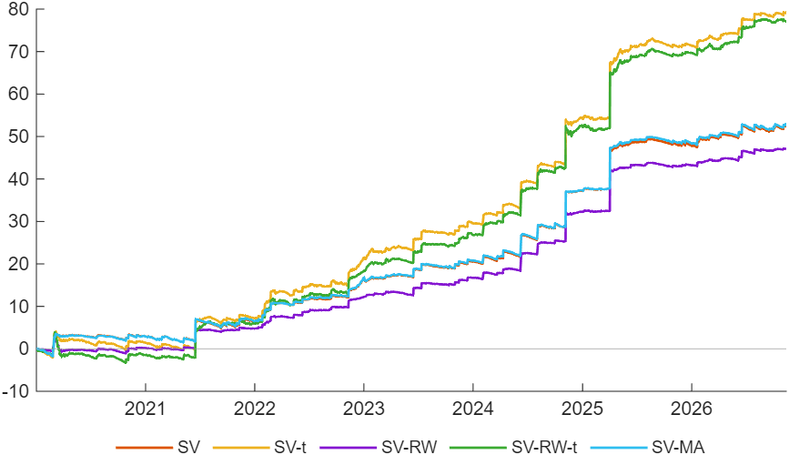
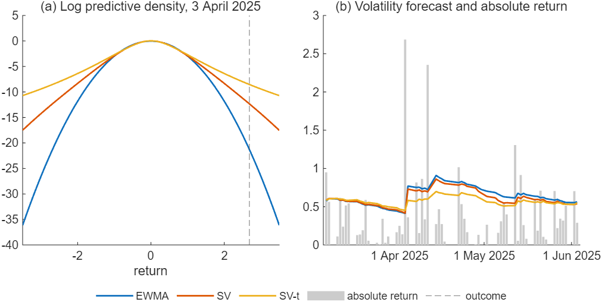

# Which Stochastic Volatility Model Forecasts Best?

*Code: [`build.m`](build.m) and [`your_data.m`](your_data.m), which call
[`ssm.models.sv`](../../core/+ssm/+models/sv.m) and
[`ssm.models.sv_forecast`](../../core/+ssm/+models/sv_forecast.m). Method:
[Kim, Shephard and Chib (1998)](../../CITING.md#kim-shephard-and-chib-1998),
[Chan (2013)](../../CITING.md#chan-2013) and
[Chan and Grant (2016)](../../CITING.md#chan-and-grant-2016b).*

We compare five stochastic volatility models by their one-day-ahead forecasts of the return on
the dollar-euro exchange rate. The log predictive likelihood and the coverage of predictive
intervals assess the predictive distribution. QLIKE and the mean squared error (MSE) assess the
forecasts of the squared return.

The comparison starts with a standard SV model: normal errors and a stationary AR(1)
log-volatility. We then consider Student-$`t`$ errors, a random-walk log-volatility and an MA(1)
term in the return equation. Together with the baseline, these changes give five models: SV,
SV-t, SV-RW, SV-RW-t and SV-MA. The sample runs from 5 January 1999 to 13 November 2026. We
evaluate the forecasts over the last 1,761 business days, from 2 January 2020. Before each
forecast, we re-estimate every model on all earlier returns.

SV-t has the highest log predictive likelihood and the lowest QLIKE and MSE. Its log predictive
likelihood exceeds that of SV by 26.6, more than four standard errors. The evidence from QLIKE is
weaker: the QLIKE of SV-t is lower than that of SV by 1.7 standard errors. The random-walk models
have slightly lower log predictive likelihoods than their stationary counterparts. The MA(1) term
raises the log predictive likelihood of SV by 0.3.

The benchmark is the exponentially weighted moving average (EWMA) of RiskMetrics. All five models
have a higher log predictive likelihood than the EWMA, by more than three standard errors. For
SV-t, the difference is 79.1. Most of it comes from a few days with large moves (Figure 1). The
QLIKE of the five models is lower than the EWMA's by 1.6 to 2.1 standard errors. Their mean
squared error is lower by at most 1.4 percent.

## Try It Now

Open a script in MATLAB and click Run, or type its command in the Command Window from the root of
the repository:

| Command | What it produces | Time |
|---|---|---|
| `run tutorials/sv_volatility/your_data.m` | the comparison on the same data over the last six days, with short chains, each model's forecast for the day after the sample, and the exported report | about a minute |
| `run tutorials/sv_volatility/build.m` | every number and figure on this page | about 10 hours with 10 parallel workers |

The short run checks that the workflow runs end to end. Its six forecasts are far too few for the
numbers on this page, which all come from the full build. Its settings block is where you point it
at your own file.



*Figure 1: The cumulative difference in log predictive likelihood of each stochastic volatility
model against the EWMA, plotted at the target day. Each line rises on a day when the model's
predictive density at the outcome exceeds the EWMA's. The lines of SV and SV-MA almost coincide.
The largest jumps are on 6 November 2024 and 3 April 2025.*

## Five SV Models and the EWMA Benchmark

The five SV models differ in three features: the dynamics of the log-volatility, the distribution
of the errors and the presence of an MA(1) term. Each row gives the change from the baseline SV
model:

| Model | Change from the baseline SV model | Log-volatility | Error distribution | MA(1) term |
|---|---|---|---|---|
| SV | baseline | stationary AR(1) | normal | no |
| SV-t | allow heavy tails | stationary AR(1) | Student-$`t`$ | no |
| SV-RW | replace mean reversion with a random walk | random walk | normal | no |
| SV-RW-t | combine a random walk with heavy tails | random walk | Student-$`t`$ | no |
| SV-MA | add serial dependence to the return equation | stationary AR(1) | normal | yes |

The first four models combine normal or Student-$`t`$ errors with a stationary or random-walk
log-volatility. The fifth, SV-MA, adds an MA(1) term to the baseline and keeps its normal errors
and stationary log-volatility. SV, SV-t and SV-MA are models of Chan and Grant (2016). The MA(1)
term comes from Chan (2013). SV-RW and SV-RW-t are random-walk variants included here for
comparison.

The return $`y_t`$ is 100 times the log change in the exchange rate from one day to the next.
All five SV models can be written as

```math
y_t = \mu + u_t + \psi u_{t-1}, \qquad u_t = \sqrt{\lambda_t}\,\mathrm{e}^{h_t/2}\varepsilon_t, \qquad \varepsilon_t \sim \mathcal{N}(0, 1), \qquad u_0 = 0,
```

where $`\psi = 0`$ outside SV-MA, and $`\lambda_t = 1`$ unless the errors have Student-$`t`$
tails. In SV-t and SV-RW-t, $`\lambda_t \sim \mathcal{IG}(\nu/2, \nu/2)`$, so $`u_t`$ has a
Student-$`t`$ distribution with $`\nu`$ degrees of freedom and scale $`\mathrm{e}^{h_t/2}`$. The
log-volatility $`h_t`$ is either a stationary AR(1) process,

```math
h_t = \mu_h + \phi(h_{t-1} - \mu_h) + \eta_t, \qquad \eta_t \sim \mathcal{N}(0, \sigma_h^2),
```

started from its stationary distribution $`h_1 \sim \mathcal{N}(\mu_h, \sigma_h^2/(1 - \phi^2))`$,
or a random walk, $`h_t = h_{t-1} + \eta_t`$, started from $`h_1 \sim \mathcal{N}(0, 10)`$.

The benchmark is the exponentially weighted moving average (EWMA) of RiskMetrics (J.P.
Morgan/Reuters, 1996). Its forecast of the next day's variance is

```math
\hat{\sigma}^2_{t+1} = 0.94\,\hat{\sigma}^2_t + 0.06\,y_t^2,
```

the recursion with the decay factor that RiskMetrics sets for daily data, and its predictive
distribution is $`\mathcal{N}(0, \hat{\sigma}^2_{t+1})`$. It has no parameters to estimate.

We use the priors in Chan and Grant (2016). They are the defaults of `ssm.models.sv`. Every
model has $`\mu \sim \mathcal{N}(0, 10)`$, and the models with Student-$`t`$ errors have
$`\nu \sim \mathcal{U}(2, 100)`$. With a stationary log-volatility,
$`\mu_h \sim \mathcal{N}(1, 10)`$, $`\phi \sim \mathcal{N}(0.97, 0.1^2)`$ on $`(-1, 1)`$ and
$`\sigma_h^2 \sim \mathcal{IG}(5, 0.16)`$, with mean 0.04. Here $`\mathcal{IG}(\nu, S)`$ has
density proportional to $`x^{-(\nu+1)}\mathrm{e}^{-S/x}`$. SV-MA has
$`\psi \sim \mathcal{N}(0, 1)`$ on $`(-1, 1)`$. For the random-walk models, we assume
$`h_1 \sim \mathcal{N}(0, 10)`$ and $`\sigma_h^2 \sim \mathcal{IG}(5, 0.04)`$, with mean 0.01.
These are also defaults of `ssm.models.sv`.

## The Function Call

Each stochastic volatility model is one call to
[`ssm.models.sv`](../../core/+ssm/+models/sv.m), and its forecast one call to
[`ssm.models.sv_forecast`](../../core/+ssm/+models/sv_forecast.m). For SV-t at one origin:

```matlab
res = ssm.models.sv(y, 'dist', 't', 'nsim', 5000, 'burnin', 1000);
f = ssm.models.sv_forecast(res);
m = mean(f.m);                   % predictive mean of the next return
v = mean(f.v) + var(f.m, 1);     % predictive variance
f2 = v + m^2;                    % forecast of the squared return, scored by QLIKE and MSE
f.logpdf(y_next)                 % log predictive density at the observed return
```

| Argument | Sets | In this tutorial |
|---|---|---|
| `y` | the returns $`y_t`$ | every return from 5 January 1999 up to the origin |
| `'vol'` | the log-volatility: `'ar1'` or `'rw'` | `'rw'` in SV-RW and SV-RW-t, `'ar1'` in the others |
| `'errors'` | the dependence of the errors: `'iid'`, `'ma'` or `'arma'` | `'ma'` in SV-MA, `'iid'` in the others |
| `'dist'` | the distribution of the errors: `'normal'` or `'t'` | `'t'` in SV-t and SV-RW-t |
| `'prior'` | the priors above | the defaults |
| `'nsim'`, `'burnin'` | the draws kept and the draws discarded first | 5,000 and 1,000 at each origin |

Each sweep of the sampler takes up to five steps:

1. $`\mu`$ from its normal conditional distribution.
2. In SV-MA, $`\psi`$, by an independence Metropolis-Hastings step at the mode of its conditional
   density, by [`ssm.ma_params`](../../core/+ssm/ma_params.m).
3. The log-volatilities, by the auxiliary mixture sampler of Kim, Shephard and Chib (1998):
   [`ssm.ksc_ar1_mean`](../../core/+ssm/ksc_ar1_mean.m) for a stationary AR(1) and
   [`ssm.ksc_rw_diffuse`](../../core/+ssm/ksc_rw_diffuse.m) for a random walk.
4. With Student-$`t`$ errors, the $`\lambda_t`$ from their inverse-gamma conditional distributions,
   and $`\nu`$ by [`ssm.nu_studentt`](../../core/+ssm/nu_studentt.m).
5. $`\mu_h`$, $`\phi`$ and $`\sigma_h^2`$ by [`ssm.sv_params`](../../core/+ssm/sv_params.m), or
   $`\sigma_h^2`$ of a random walk from its inverse-gamma conditional distribution.

## Results for the Dollar-Euro Rate

The data are [`examples/data/USDEUR_daily.csv`](../../examples/data/USDEUR_daily.csv), the euro
reference rate of the European Central Bank in US dollars, from 4 January 1999 to 13 November
2026. The return is 100 times the log change in the rate from one business day to the next. The
7,135 returns have a standard deviation of 0.580 and a kurtosis of 6.32.

*Table 1: Evaluation of one-day-ahead return-density and volatility forecasts over 1,761 days,
from 2 January 2020 to 13 November 2026. The log predictive likelihood is the sum of the log
predictive densities at the observed returns. QLIKE and MSE score the predicted second moment
(predictive variance plus squared predictive mean) against the squared return. The QLIKE column
is the model's average loss minus the EWMA's, and the MSE column is the ratio of the mean squared
errors. In parentheses are standard errors from the long-run variance estimator of Newey and
West (1987), with 10 lags. Coverage is the share of returns inside the predictive interval.*

| Model | Log predictive likelihood | Difference against EWMA (s.e.) | QLIKE difference against EWMA (s.e.) | MSE relative to EWMA | 90% interval coverage | 98% interval coverage |
|---|---|---|---|---|---|---|
| EWMA | -1090.4 | 0.0 | 0.0000 | 1.000 | 0.897 | 0.961 |
| SV | -1037.9 | 52.6 (16.1) | -0.0153 (0.0096) | 0.994 | 0.912 | 0.974 |
| SV-t | -1011.3 | 79.1 (21.2) | -0.0235 (0.0111) | 0.986 | 0.908 | 0.977 |
| SV-RW | -1043.3 | 47.1 (13.9) | -0.0117 (0.0059) | 0.995 | 0.901 | 0.969 |
| SV-RW-t | -1013.4 | 77.1 (20.5) | -0.0178 (0.0102) | 0.987 | 0.899 | 0.973 |
| SV-MA | -1037.6 | 52.8 (16.4) | -0.0154 (0.0094) | 0.994 | 0.911 | 0.974 |

The 90% predictive intervals of all six models contain between 89.7 and 91.2 percent of the
returns. The 98% intervals of the EWMA contain 96.1 percent, and those of the stochastic
volatility models 96.9 to 97.7 percent. The EWMA's 98% intervals miss 3.9 percent of the returns,
about twice the nominal 2 percent. The volatility forecast of a model is the square root of its
forecast of the squared return. The volatility forecasts of the six models have correlations of
0.234 to 0.240 with the absolute return.

### Student-t Errors, a Random Walk or an MA(1) Term?

*Table 2: Pairwise comparisons of model features, reported as differences in the sum of log
predictive likelihoods and in average QLIKE. Newey-West standard errors are in parentheses. The
random-walk comparisons also change the priors on $`h_1`$ and $`\sigma_h^2`$, as given above.*

| Feature | Comparison | Log predictive likelihood difference (s.e.) | QLIKE mean difference (s.e.) |
|---|---|---|---|
| Student-t errors | SV-t minus SV | 26.6 (6.4) | -0.0082 (0.0047) |
| Student-t errors | SV-RW-t minus SV-RW | 29.9 (7.4) | -0.0061 (0.0053) |
| Random-walk log-volatility | SV-RW minus SV | -5.4 (5.1) | 0.0036 (0.0075) |
| Random-walk log-volatility | SV-RW-t minus SV-t | -2.0 (4.3) | 0.0057 (0.0080) |
| MA(1) errors | SV-MA minus SV | 0.3 (0.7) | -0.0001 (0.0015) |

Student-$`t`$ errors raise the log predictive likelihood by 26.6 with a stationary log-volatility
and by 29.9 with a random walk. Both gains are about four standard errors. On the whole sample, the
degrees of freedom $`\nu`$ of SV-t have posterior mean 9.2, with 90% interval (7.8, 11.0). A
random-walk log-volatility lowers the log predictive likelihood by 5.4 with normal errors and by
2.0 with Student-$`t`$ errors, about one standard error or less. The MA(1) term raises it by 0.3.
Daily returns on the rate are close to uncorrelated, with a first autocorrelation of -0.007. On
the whole sample, the posterior mean of $`\psi`$ in SV-MA is -0.010, with 90% interval
(-0.030, 0.010).

Student-$`t`$ errors also lower the average QLIKE of SV by 0.0082, 1.7 standard errors. The other
QLIKE differences in Table 2 are within 1.2 standard errors.

### Where Does the Gain over the EWMA Come From?

Most of the gain of SV-t over the EWMA comes from a few days with large moves (Figure 1). SV-t has
a higher log predictive likelihood than the EWMA on 805 of the 1,761 days. Its ten largest gains
add up to 53.8 of its 79.1. The largest gain comes on 3 April 2025, the day after the US announced
tariffs on imports from most countries. The second largest comes on 6 November 2024, the day after
the US presidential election. The returns on these days are 2.69 and -1.87 percent, 6.5 and 6.0
times the EWMA's volatility forecast. The gain of SV-t is positive in every year of the sample:
the smallest is 1.4, in 2020, and the largest 24.7, in 2024.

The volatility forecasts for 3 April 2025 are close: 0.41, 0.42 and 0.45 percent from the EWMA, SV
and SV-t. The predictive densities differ in the tails, where the outcome falls (Figure 2). At the
outcome, the log density of SV-t is higher than the EWMA's by 12.7, and that of SV by 8.9. The
predictive density of SV is a mixture of normal densities over the draws of the next day's
log-volatility. Such a mixture has heavier tails than a normal density with the same variance. On
6 November 2024, the log density of SV-t is higher than the EWMA's by 10.5.



*Figure 2: The day of the largest gain of SV-t over the EWMA, 3 April 2025. (a) The log
predictive densities of the EWMA, SV and SV-t for that day, with the outcome. (b) Their
volatility forecasts from 6 March to 3 June 2025, with the absolute return.*

After a large move, the volatility forecast of SV-t rises less than those of the EWMA and SV. In
SV-t, a large move raises the posterior means of both the latent scale $`\lambda_t`$ of that day
and the log-volatility. The $`\lambda_t`$ are independent over time, so only the rise in the
log-volatility raises the forecast for the next day. For 4 April 2025, after the move, the EWMA,
SV and SV-t forecast a volatility of 0.77, 0.73 and 0.58 percent (Figure 2). On each of the ten
days with the largest gains, the volatility forecast of SV-t rises the least from that day to the
next.

## How the Forecasts Are Computed and Evaluated

At each origin, each model is estimated by Markov chain Monte Carlo on every return from 5 January
1999 up to that day. This expanding window follows the forecasting code of Chan and Grant (2016).
Each chain keeps 5,000 draws after a burn-in of 1,000.

At each posterior draw, [`ssm.models.sv_forecast`](../../core/+ssm/+models/sv_forecast.m)
simulates the log-volatility one day ahead from its last value. Given that value, the next return
is normal, or Student-$`t`$ in SV-t and SV-RW-t, with mean $`\mu + \psi u_t`$. The predictive
density is the average of these densities over the draws, and its quantiles give the predictive
intervals. Given each draw, the variance of the next return has a closed form, with the
log-volatility integrated out. It is $`\mathrm{e}^{a + \sigma_h^2/2}`$, where $`a`$ is the mean of
$`h_{t+1}`$, times $`\nu/(\nu - 2)`$ under Student-$`t`$ errors. The forecast of the next day's
variance is the average of these variances over the draws plus the variance of the means.

The log predictive likelihood evaluates this full predictive distribution at the observed
return. Predictive interval coverage measures how often the return falls inside the model's 90%
and 98% intervals. These criteria assess the distribution, including its center, dispersion and
tails.

For QLIKE and MSE, we score a forecast of the squared return. Write $`\hat{m}_{t+1}`$ for the
predictive mean and $`\hat{v}_{t+1}`$ for the predictive variance. The forecast used in the
loss functions is

```math
\hat{f}_{t+1} = \hat{v}_{t+1} + \hat{m}_{t+1}^{\,2}.
```

This is the predictive second moment. The two losses are

```math
\mathrm{QLIKE} = \log \hat{f}_{t+1} + \frac{y_{t+1}^2}{\hat{f}_{t+1}}, \qquad \mathrm{MSE} = (y_{t+1}^2 - \hat{f}_{t+1})^2 .
```

The squared return is a noisy observation of the conditional second moment,
$`\mathbb{E}(y_{t+1}^2 \mid y_{1:t})`$. That second moment equals the conditional variance plus
the squared conditional mean. It equals the conditional variance when the conditional mean is
zero. Every forecast here includes the squared predictive mean.

For QLIKE and MSE, replacing a target by a conditionally unbiased proxy preserves rankings by
expected loss, provided the relevant moments exist. Patton (2011) develops this robustness
property for volatility forecast comparisons. Here the target is the conditional second moment.
The property concerns rankings by expected loss. In a finite sample, noisy squared returns make
differences between models harder to detect.

## Checking the Estimates

The build checks the predictive distributions before it uses them. Each stochastic volatility
model is estimated on the whole sample. Its distribution function from `ssm.models.sv_forecast`
matches next-day returns simulated forward from the same posterior draws. The two differ by at
most 0.0052 at the 5th to 95th percentiles of the simulated values.

The inefficiency factors of the parameters run from 1.0 to 74, in the whole-sample chains with a
Bartlett window of 100 lags. The highest belong to $`\sigma_h^2`$. The Metropolis-Hastings
steps accept often: 96 to 97 percent of the candidates for $`\phi`$, 99 percent for $`\nu`$ and
more than 99 percent for $`\psi`$.

## What Can Go Wrong

- **Returns in decimals.** The sampler of the log-volatility adds 0.0001 to each squared error
  before it takes logs, so that a zero return has a finite log. In percent, the mean squared
  return of the dollar-euro rate is 0.34, far above that constant. In decimals it is 0.000034,
  below it, and the constant would then dominate the estimated volatility. The priors are also set
  for returns in percent. Multiply returns in decimals by 100.
- **Many zero returns.** The rate is published to four decimals, so on 56 of the 7,135 days it is
  unchanged and the return is zero. A series with many zeros, such as a pegged currency or a thinly
  traded asset, does not fit these models.
- **Noisy evaluation of volatility forecasts.** A squared return is a noisy observation of the
  conditional second moment. Many days are needed to distinguish models by QLIKE or the mean
  squared error. Over the 1,761 days here, the QLIKE of each SV model is below the EWMA's by 1.6
  to 2.1 standard errors.

## Applying the Method to Your Data

The script [`your_data.m`](your_data.m) runs the same comparison on a daily series. Its settings
block sets the data: the file, the column, the date column, and whether the column holds prices
or returns. It also sets the models, the estimation window, the number of origins, the draws per
model and the seed. The last two settings control the forecast for the day after the last one
and where the report goes. The window `W = Inf` uses every return up to the origin, as the build
does, and a finite `W` uses the last `W` returns. A price or exchange rate becomes 100 times its
log change. A return should be in percent, the scale the priors are set for. The script drops
rows without a value, such as holidays. It stops on a series with fewer than 200 returns before
the first origin and on a constant series. It also stops on a price that is not positive and on
dates that are not increasing or not daily.

Each forecast comes from one call,

```matlab
r = fc_origin(y, t, Inf, 'SV-t', struct('nsim', 5000, 'burnin', 1000), seed);
```

which estimates the model on `y(1:t)`. It returns the mean and variance of the predictive
distribution of `y(t+1)`, its log predictive likelihood and its 1st, 5th, 95th and 99th
percentiles. With `t = numel(y)` it forecasts the day after the last, and the log predictive
likelihood is `NaN`. It is in [`private/`](private/), with the EWMA and the options of each model,
so scripts in this folder can call them. A new model is a new entry in `sv_options`.

The script writes what it computed to `outdir`, which defaults to `tempdir` so that a run leaves
the repository unchanged. The file `sv_volatility_report.csv` holds one row per model, with its
scores and its forecast for the day after the last. The file `sv_volatility_report.mat` holds
that table with the settings behind it. Setting `outdir = ''` turns the export off.

## Reproducing the Results

To reproduce all results on this page, open the build script and click Run, or type in the Command
Window from the root of the repository:

```matlab
run tutorials/sv_volatility/build.m
```

The script `build.m` checks the EWMA recursion and the predictive distributions. It then runs one
chain per model on the whole sample and the recursive forecasts, scores them and draws the
figures. With the Parallel Computing Toolbox it runs the forecasts on parallel workers, and
without it one after another, which takes several times as long. Each forecast has its own seed,
so serial and parallel runs give the same forecasts, to within 1e-14. The forecasts are saved in
blocks of 50 origins in `runs/`, which is not part of the repository. An interrupted build resumes
where it stopped. A block is used again only if its settings and origins match those of the run.
The computation takes 9.9 hours with 10 parallel workers, using MATLAB R2025b. The computer has
an Intel Core Ultra 7 255U processor and 32 GB of RAM.

The script prints every result in this tutorial, or the numbers they are computed from. It saves
the figures in the same folder as this page, together with [`forecasts.csv`](forecasts.csv), which
holds every forecast. The file has one row per model and origin. Each row holds the target day,
the realized return, the predictive mean and variance, and the log predictive density at the
outcome. It also holds the bounds of the 90% and 98% predictive intervals.

## References

Chan, J. C. C. (2013). Moving Average Stochastic Volatility Models with Application to Inflation
Forecast. *Journal of Econometrics*, 176(2): 162-172.
[doi:10.1016/j.jeconom.2013.05.003](https://doi.org/10.1016/j.jeconom.2013.05.003)

Chan, J. C. C. and Grant, A. L. (2016). Modeling Energy Price Dynamics: GARCH versus Stochastic
Volatility. *Energy Economics*, 54: 182-189.
[doi:10.1016/j.eneco.2015.12.003](https://doi.org/10.1016/j.eneco.2015.12.003)

J.P. Morgan/Reuters (1996). *RiskMetrics: Technical Document*, fourth edition. Morgan Guaranty
Trust Company, New York.

Kim, S., Shephard, N. and Chib, S. (1998). Stochastic Volatility: Likelihood Inference and
Comparison with ARCH Models. *Review of Economic Studies*, 65(3): 361-393.
[doi:10.1111/1467-937X.00050](https://doi.org/10.1111/1467-937X.00050)

Newey, W. K. and West, K. D. (1987). A Simple, Positive Semi-Definite, Heteroskedasticity and
Autocorrelation Consistent Covariance Matrix. *Econometrica*, 55(3): 703-708.
[doi:10.2307/1913610](https://doi.org/10.2307/1913610)

Patton, A. J. (2011). Volatility Forecast Comparison Using Imperfect Volatility Proxies. *Journal
of Econometrics*, 160(1): 246-256.
[doi:10.1016/j.jeconom.2010.03.034](https://doi.org/10.1016/j.jeconom.2010.03.034)

[`CITING.md`](../../CITING.md) lists the paper to cite for each model and method. To cite the
toolkit itself: Chan, J. C. C. (2026). *statespace-toolkit: MATLAB code for Bayesian state space
models*. Zenodo. [doi:10.5281/zenodo.22884655](https://doi.org/10.5281/zenodo.22884655)

The BibTeX entries are:

```bibtex
@article{chan2013,
  author  = {Chan, Joshua C. C.},
  title   = {Moving Average Stochastic Volatility Models with Application to Inflation Forecast},
  journal = {Journal of Econometrics},
  volume  = {176},
  number  = {2},
  pages   = {162--172},
  year    = {2013},
  doi     = {10.1016/j.jeconom.2013.05.003}
}
@article{chan_grant2016,
  author  = {Chan, Joshua C. C. and Grant, Angelia L.},
  title   = {Modeling Energy Price Dynamics: {GARCH} versus Stochastic Volatility},
  journal = {Energy Economics},
  volume  = {54},
  pages   = {182--189},
  year    = {2016},
  doi     = {10.1016/j.eneco.2015.12.003}
}
@article{kim_shephard_chib1998,
  author  = {Kim, Sangjoon and Shephard, Neil and Chib, Siddhartha},
  title   = {Stochastic Volatility: Likelihood Inference and Comparison with {ARCH} Models},
  journal = {Review of Economic Studies},
  volume  = {65},
  number  = {3},
  pages   = {361--393},
  year    = {1998},
  doi     = {10.1111/1467-937X.00050}
}
@article{newey_west1987,
  author  = {Newey, Whitney K. and West, Kenneth D.},
  title   = {A Simple, Positive Semi-Definite, Heteroskedasticity and Autocorrelation Consistent
             Covariance Matrix},
  journal = {Econometrica},
  volume  = {55},
  number  = {3},
  pages   = {703--708},
  year    = {1987},
  doi     = {10.2307/1913610}
}
@article{patton2011,
  author  = {Patton, Andrew J.},
  title   = {Volatility Forecast Comparison Using Imperfect Volatility Proxies},
  journal = {Journal of Econometrics},
  volume  = {160},
  number  = {1},
  pages   = {246--256},
  year    = {2011},
  doi     = {10.1016/j.jeconom.2010.03.034}
}
@misc{statespace_toolkit,
  author       = {Chan, Joshua C. C.},
  title        = {statespace-toolkit: {MATLAB} Code for {B}ayesian State Space Models},
  year         = {2026},
  howpublished = {Zenodo},
  doi          = {10.5281/zenodo.22884655},
  url          = {https://github.com/joshuaccchan/statespace-toolkit}
}
```
